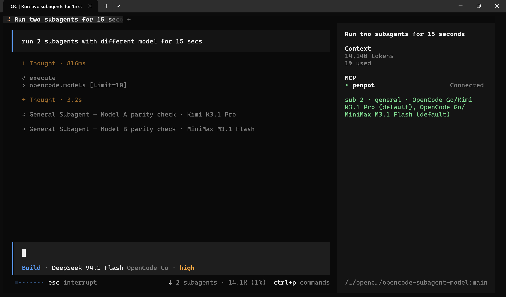

# opencode-subagent-model

[](https://github.com/chatteridiot-git/agent-live-status-plugin/blob/main/LICENSE)

Live model status for running subagents in the OpenCode TUI.

This plugin shows which model each active subagent is using, so you can quickly understand what is running without opening each session individually.

It is especially useful when you use different models for your main agent and subagents and want to confirm that each subagent is using the intended model from its configuration.

## Live preview



## Why use it

- See live model information for each running subagent
- Browse all active subagents from one searchable picker
- Open any subagent session directly from the UI
- Keep the status compact when you want less visual noise

## Example output

One row per running subagent, oldest first, with a five-box context indicator:

```text
Sub Agents
 1.explore   Go/Kimi K3.1 Pro ▮▮▮▯▯
 2.general   Go/MiniMax M3.1… ▮▯▯▯▯
 3.code      Go/GPT-6 Luna    ▮▮▮▮▯
 4.review    Go/Grok 4.7      ▮▮▯▯▯
```

The `Sub Agents` title and the rows render only while at least one subagent is
running; with none running the slot stays empty.

Numbers are reserved for two digits, so `10.` lines up with ` 1.` and the rows
never reflow. Past twenty rows they collapse into one overflow line:

```text
+1 more · /subagents
```

The model label is capped at 20 cells (16 at the default `width: 35`), and clips
with `…` past that. Boxes show how full the model context window is:
`filled = round(pct × 5 / 100)`. The row text is green. Boxes are green below
50%, yellow from 50%, red from 70%. A subagent with no usage data yet shows
empty muted boxes.

Compact mode keeps the old summary:

```text
sub 3
```

## Features

- Live status summary in the session UI (`sidebar.content` by default)
- Numbered per-subagent rows with a model and a context-window indicator
- `/subagents` command and `/subagent-models` alias
- Palette command: `Show running subagent models`
- Palette command: `Toggle compact subagent status`
- Type-to-filter picker for agent, model, title, and elapsed time
- Direct open action for each subagent session

## How it works

The plugin inspects the active session family and shows child sessions that are currently marked as `running`.

It resolves the model in this order:

1. the session model
2. the subagent's configured agent model
3. the nearest parent session model
4. `unknown model`

The displayed label follows the format `ProviderName/ModelName`, and appends ` (variant)` when relevant. If a label is missing, the plugin falls back to the provider or model ID.

The sidebar rows use the short form: the provider's last word (`OpenCode Go` → `Go`) and no variant.

The context indicator reads the newest message that reports token usage and divides its prompt size (`input + cache read`) by the model's context limit. Cumulative session tokens are not used: they never fall after compaction, so the bar would never recover.

## Commands

### `/subagents`

Opens a searchable list of running subagents.

It includes:

- agent name
- resolved model
- session title
- elapsed time
- session ID

Type to filter the list. Press Enter to open the selected session, or use `alt+o` to open it without closing the picker.

Example:

```text
/subagents explore
```

### Palette commands

- `Show running subagent models`
- `Toggle compact subagent status`

## Configuration

Add the plugin in `opencode.jsonc`:

```jsonc
{
  "plugins": [
    {
      "package": "opencode-subagent-model",
      "options": {
        "placement": "sidebar.content",
        "bind": "ctrl+shift+s",
        "compact": false,
        "width": 35
      }
    }
  ]
}
```

### Options

| Option | Type | Default | Meaning |
|---|---|---|---|
| `placement` | `"sidebar.content"` \| `"sidebar.footer"` \| `"prompt.footer"` | `"sidebar.content"` | Where the live status is rendered |
| `bind` | `string` | unset | Keybind for the subagent picker |
| `compact` | `boolean` | unset | Forces compact mode (`sub N`) |
| `width` | `number` | `35` | Cell budget for a sidebar row; the model label clips to fit |

## Installation

The plugin is discovered from the OpenCode plugin directories.

Global config path:

```text
~/.config/opencode/plugins/opencode-subagent-model/
```

Project-local path:

```text
<project>/.opencode/plugins/opencode-subagent-model/
```

You can also symlink the plugin directory into place:

```sh
ln -s /path/to/opencode-subagent-model ~/.config/opencode/plugins/opencode-subagent-model
```

After installation, reload the TUI with `/reload` or restart OpenCode.

## Development

```sh
npm install
npm run typecheck
npm test
```

## Repository layout

```text
package.json             package metadata and exports
src/index.ts             plugin bootstrap entry
src/tui.tsx              TUI commands, slots, and dialogs
src/lib/collect.ts       model resolution and summary logic
src/lib/collect.test.ts  unit tests for the data layer
```

## License

MIT
